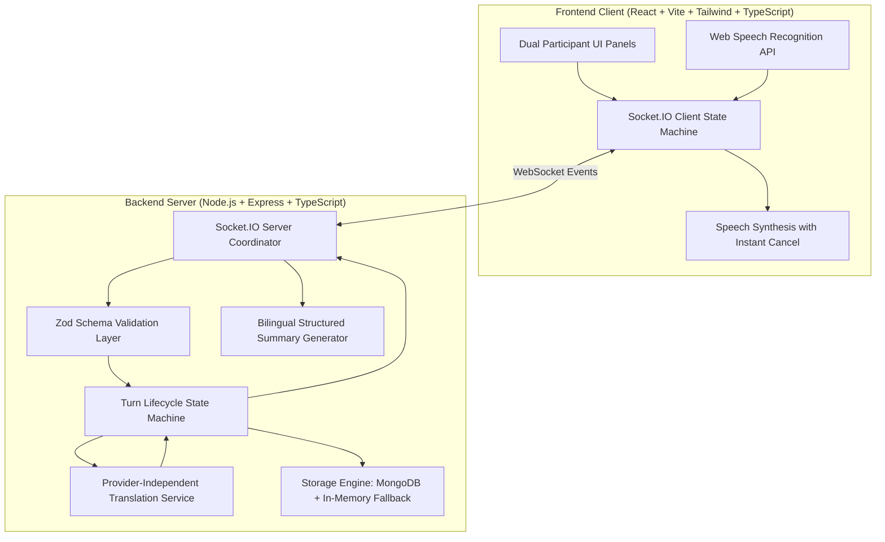

# VerbaLoop — Real-Time Multilingual Conversation Platform

> **Tagline:** Different languages. One conversation.

[-emerald.svg)](#testing-and-verification)
[](#technology-stack)
[](#real-time-event-contracts)
[](LICENSE)

---

## 1. Product Vision

**VerbaLoop** enables two real people who speak completely different languages to have a natural, real-time conversation — complete with heated disagreements, spontaneous interruptions, emotional reactions, clarifications, changes of mind, and mutual understanding.

Unlike conventional translation forms, text chatbots, or synthetic video avatars, VerbaLoop models authentic human communication. If Participant A speaks **Hindi** and Participant B speaks **Mandarin Chinese**:
- Participant A speaks naturally in Hindi and hears / reads the Mandarin translation in real time.
- Participant B responds in Mandarin and receives the Hindi translation immediately.
- Both participants view original messages side by side with high-fidelity translations.
- Either participant can **interrupt translated audio mid-speech**, correct a misunderstanding, take a pause, or rephrase a point before arguments derail.
- At the end of the conversation, an objective **structured bilingual summary** is generated in both participants' native tongues.

---

## 2. Product Analysis: ZERO (`zero4genz.in`) Lineup

As part of the design and product exploration of youth-led innovation at **ZERO**, here is an architectural analysis of ZERO's three core products, identifying the central problem and the highest-leverage first improvement to build (each under 150 words):

### 1. CLOSURE
* **Problem**: Freshers and early-career job applicants face silent ghosting and impersonal, opaque automated ATS rejections. Candidates invest hours tailoring applications, only to receive generic rejections without actionable feedback, leaving them demoralized and unaware of specific resume disqualifiers or interview gaps.
* **First Improvement to Build**: Implement an **automated ATS & Job Match Audit Engine** alongside human review. When a candidate submits their resume and target job description, generate an instant candidate-to-JD semantic score, highlighting the top 3 missing hard skills, formatting syntax errors, and bullet-point rewrites, before routing to human experts for qualitative portfolio polish.

### 2. The Middle Market
* **Problem**: Micro and small businesses in emerging markets rely heavily on WhatsApp for customer acquisition, order taking, and inquiries. However, solo business owners face chaotic message volume, scattered chats, and lost revenue caused by delayed replies during peak operational hours.
* **First Improvement to Build**: Develop an **AI-Assisted WhatsApp Business Inbox with Real-Time Catalog Sync**. Provide automated, context-aware instant answers for pricing, product availability, and shipping timelines, while automatically categorizing incoming chats into a visual Kanban board (Lead → Quoted → Paid → Dispatched).

### 3. ISHQweds
* **Problem**: Indian weddings are multi-day, emotionally intense productions characterized by fragmented vendor coordination, scattered guest lists across disparate WhatsApp groups, and last-minute logistical chaos regarding guest itineraries, dietary preferences, and travel arrivals.
* **First Improvement to Build**: Build a **Centralized Guest Companion Web App & WhatsApp RSVP Concierge**. Enable couples to share a single personalized link where guests confirm attendance for individual events, log dietary restrictions, access live venue maps, and receive real-time schedule adjustments directly through automated WhatsApp alerts.

---

## 3. Architecture & Real-Time Interruption Handling

### System Architecture Diagram



### The Interruption Invariant

In real debate, interruptions are not decorative buttons. When Participant B interrupts Participant A:
1. **Immediate Audio Cancellation**: The client triggers `window.speechSynthesis.cancel()` the instant the interrupt event fires, silencing audio playback in under 80ms.
2. **Turn State Transition**: The active turn status immediately shifts from `speaking` / `playing` to `interrupted`.
3. **Server-Side Invalidation**: The server purges any in-flight translation or audio synthesis promises tied to the interrupted turn ID, preventing stale responses from polluting the room.
4. **Floor Prioritization**: The active turn floor is cleared, giving the interrupting speaker immediate priority to speak.
5. **Partial Transcript Preservation**: The words uttered prior to the interruption are stored and tagged with an `Interrupted` badge rather than discarded.

---

## 4. Socket.IO Real-Time Event Contracts

All real-time events are typed and validated with strict **Zod** schemas:

| Event Name | Direction | Payload Structure | Purpose |
| :--- | :--- | :--- | :--- |
| `room:create` | Client → Server | `{ hostName, hostLanguage, topic? }` | Generates 6-character room code & sets host |
| `room:join` | Client → Server | `{ roomCode, participantName, participantLanguage }` | Connects second participant to private room |
| `participant:ready` | Client → Server | `{ roomCode, participantId, isReady, isAudioReady }` | Synchronizes readiness & audio checks |
| `turn:start` | Client → Server | `{ roomCode, turnId, speakerId, inputType }` | Claims floor, sets turn status to `speaking` |
| `turn:partial` | Client → Server | `{ roomCode, turnId, speakerId, partialText }` | Streams live interim speech recognition |
| `turn:complete` | Client → Server | `{ roomCode, turnId, speakerId, originalText }` | Triggers provider-independent translation |
| `translation:complete` | Server → Client | `{ roomCode, turnId, originalText, translatedText, targetLanguage }` | Delivers translation & starts audio |
| `turn:interrupt` | Client ↔ Server | `{ roomCode, turnId, interruptedBy, reason? }` | Halts remote audio & frees floor |
| `turn:cancel` | Client ↔ Server | `{ roomCode, turnId, speakerId, reason? }` | Aborts drafting turn |
| `turn:correct` | Client ↔ Server | `{ roomCode, turnId, speakerId, correctedText }` | Re-translates and updates clarified turn |
| `audio:playback-start` | Client → Server | `{ roomCode, turnId, participantId }` | Syncs `playing` indicator on peer screen |
| `audio:playback-stop` | Client → Server | `{ roomCode, turnId, participantId }` | Turns off active listening indicators |
| `conversation:pause` | Client ↔ Server | `{ roomCode, participantId, reason? }` | Enters "I need a moment" state |
| `conversation:resume` | Client ↔ Server | `{ roomCode, participantId }` | Restores conversation to active state |
| `conversation:end` | Client ↔ Server | `{ roomCode, participantId }` | Concludes debate & creates bilingual summary |
| `conversation:delete` | Client ↔ Server | `{ roomCode, participantId }` | Permanently deletes transcripts & metadata |
| `participant:disconnect`| Server → Client | `{ roomCode, participantId, timestamp }` | Displays peer connection loss banner |

---

## 5. Supported Languages

VerbaLoop supports 10 global languages out of the box:

| Language | Code | Native Script | Speech Code | Sample Conversational Interjection |
| :--- | :--- | :--- | :--- | :--- |
| **English** | `en` | English | `en-US` | "Wait, let me finish." |
| **Hindi** | `hi` | हिन्दी | `hi-IN` | "रुकिए, मुझे अपनी बात पूरी करने दीजिए।" |
| **Mandarin Chinese** | `zh` | 中文 (普通话) | `zh-CN` | "等等，让我先把话说完。" |
| **Spanish** | `es` | Español | `es-ES` | "Espera, déjame terminar." |
| **French** | `fr` | Français | `fr-FR` | "Attends, laisse-moi finir." |
| **Arabic** | `ar` | العربية | `ar-SA` | "انتظر، دعني أكمل حديثي." |
| **Japanese** | `ja` | 日本語 | `ja-JP` | "待ってください、最後まで言わせてください。" |
| **German** | `de` | Deutsch | `de-DE` | "Warte, lass mich ausreden." |
| **Portuguese** | `pt` | Português | `pt-BR` | "Espere, deixe-me terminar." |
| **Russian** | `ru` | Русский | `ru-RU` | "Подождите, дайте мне закончить." |

---

## 6. Technology Stack

- **Frontend**:
  - React 18, Vite, TypeScript
  - Tailwind CSS with custom warm off-white (`#FAF8F5`), charcoal (`#191E24`), and teal (`#0D9488`) design tokens
  - Lucide React icons
  - Canvas Confetti for summary celebration
  - Native Web Speech API (SpeechRecognition & SpeechSynthesis)
- **Backend**:
  - Node.js, Express, TypeScript
  - Socket.IO 4.7
  - Zod 3.23 validation
  - Helmet security headers & CORS origin validation
  - Express Rate Limit
- **Database & Persistence**:
  - Dual-mode storage engine:
    - **MongoDB via Mongoose** (when `MONGODB_URI` is provided)
    - **In-Memory Repository** (automatic resilient fallback for local evaluation and offline testing)
- **AI & Translation**:
  - Provider-independent translation adapter
  - Google Gemini (`gemini-1.5-flash`)
  - OpenAI (`gpt-4o-mini`)
  - MyMemory Free REST API (zero keys required)
  - High-performance local conversational phrase dictionary & argument fallback engine
- **Testing**:
  - Vitest 2.1 across server and client
  - Supertest for REST API integration tests
  - React Testing Library & jsdom for frontend verification

---

## 7. Quickstart & Local Setup

### Prerequisites
- Node.js >= 18.0.0 (Tested on Node v24.15.0)
- npm >= 9.0.0

### Installation

1. **Clone or navigate to the repository:**
   ```bash
   cd d:\VerbaLoop
   ```

2. **Install all dependencies across workspaces:**
   ```bash
   npm install
   ```

3. **Configure Environment Variables:**
   ```bash
   cp .env.example .env
   ```
   *(Optional)* Add your `GEMINI_API_KEY` or `OPENAI_API_KEY` to `.env`. If left empty, VerbaLoop operates seamlessly using its built-in free translation engine and conversational dictionary.

4. **Run the Application:**
   To run both backend server and frontend client concurrently:
   ```bash
   npm run dev:all
   ```
   Or run individually in two terminal windows:
   ```bash
   # Terminal 1: Backend Server (Port 5000)
   npm --workspace=server run dev

   # Terminal 2: Frontend Client (Port 5173)
   npm --workspace=client run dev
   ```

5. **Open in Browser:**
   Navigate to [http://localhost:5173](http://localhost:5173).

---

## 8. Interactive Demo Mode

VerbaLoop includes a full-featured, zero-credentials **Demo Mode**:
- Access by clicking **"Try Demo"** on the landing page or header.
- Simulates an authentic high-stakes argument between **Arjun (speaking Hindi 🇮🇳)** and **Mei (speaking Mandarin Chinese 🇨🇳)** discussing:
  *"Security Audits vs. Release Velocity in Production Deployments"*.
- **Interactive Scenarios Demonstrated**:
  1. Turn 1: Direct argument initiated in Hindi -> translated to Mandarin.
  2. Turn 2: Counter-argument delivered in Mandarin -> translated to Hindi.
  3. Turn 3: **Live Interruption Triggered** mid-sentence, halting audio playback in <100ms.
  4. Turn 4: **Nuance Rephrase & Correction** updating both transcripts.
  5. Turn 5: **"I Need a Moment"** pause and resume cycle.
  6. Turn 6: **Explicit Change-of-Mind** detected for final consensus.
  7. End of Conversation: Displays the structured bilingual summary viewable in both Hindi and Mandarin.

---

## 9. Testing and Verification

VerbaLoop comes equipped with a comprehensive test suite covering all critical flows:
- Room creation and joining validation
- Turn lifecycle state machine
- Real interruption and audio cancellation
- Stale response filtering
- Fallback translation and fast-path conversational dictionary
- Structured bilingual summary generation
- Permanent conversation deletion
- UI components and keyboard accessibility

### Run All Tests:
```bash
npm test
```

### Run Server Tests Individually:
```bash
npm --workspace=server run test
```

### Run Client Tests Individually:
```bash
npm --workspace=client run test
```

### Production Build:
```bash
npm run build
```

---

## 10. Security, Privacy & Compliance

- **No Secret Audio Recording**: Voice input is processed ephemerally for transcription and immediately released from memory.
- **Ephemeral Room Scoping**: Rooms require a valid 6-character room code; max capacity of 2 participants enforces 1-on-1 focus.
- **No Client Credential Exposure**: All external AI provider credentials reside strictly on the server.
- **Permanent Deletion**: Clicking the trash icon permanently removes room state, message history, and summaries.
- **Honest Encryption Documentation**: WebSocket and REST payloads are encrypted in transit via WSS/TLS. Client-to-client E2EE is not claimed because server-side neural translation is required.

---

## 11. Cost Considerations & Provider Limitations

| Provider | Model | Latency | Estimated Cost (per 1K turns) | Notes |
| :--- | :--- | :--- | :--- | :--- |
| **Google Gemini** | `gemini-1.5-flash` | ~250–400ms | ~$0.04 | Optimal balance of speed, cost, and tone fidelity |
| **OpenAI** | `gpt-4o-mini` | ~300–500ms | ~$0.06 | Strong multilingual colloquial translation |
| **MyMemory** | Public REST API | ~400–800ms | Free ($0.00) | Public tier has rate limits (~5,000 words/day) |
| **Local Engine** | Fast-path dictionary | <5ms | Free ($0.00) | Zero latency for argument interjections |

---

## 12. Production Deployment

### Docker Deployment
A standard production Dockerfile can build both frontend and backend:
```dockerfile
FROM node:20-alpine AS builder
WORKDIR /app
COPY package*.json ./
COPY shared ./shared
COPY server ./server
COPY client ./client
RUN npm install
RUN npm run build

FROM node:20-alpine AS runner
WORKDIR /app
COPY --from=builder /app/package*.json ./
COPY --from=builder /app/node_modules ./node_modules
COPY --from=builder /app/shared ./shared
COPY --from=builder /app/server/dist ./server/dist
COPY --from=builder /app/client/dist ./client/dist
EXPOSE 5000
CMD ["node", "server/dist/server.js"]
```

---

## 13. License

MIT © VerbaLoop Team. Different languages. One conversation.
